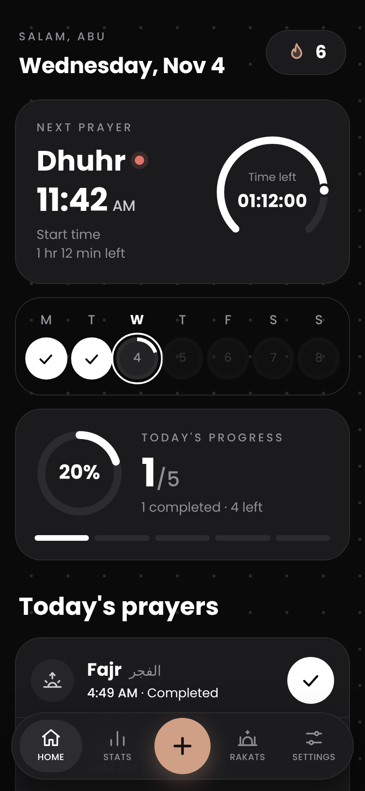
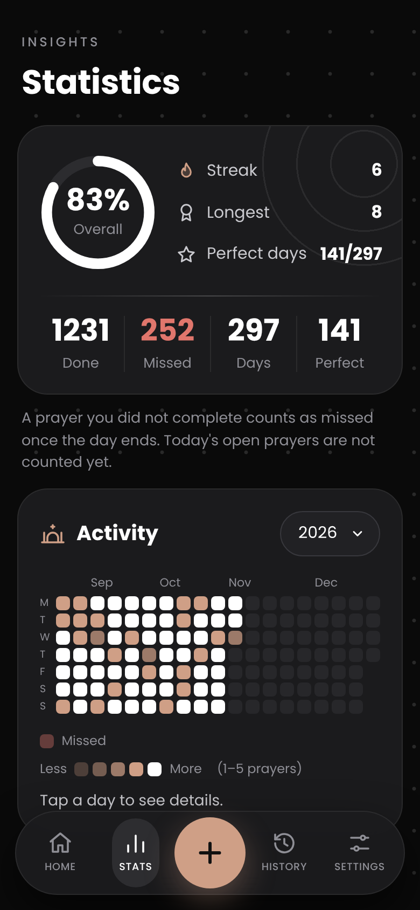
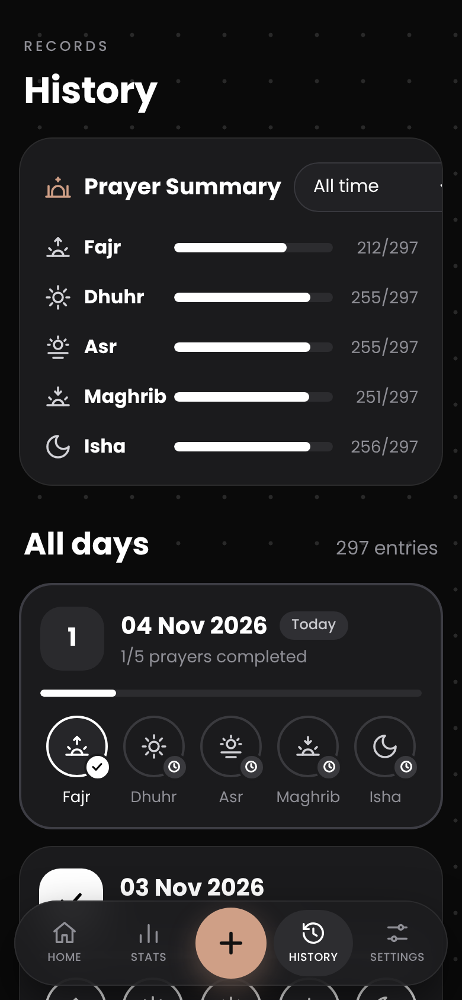
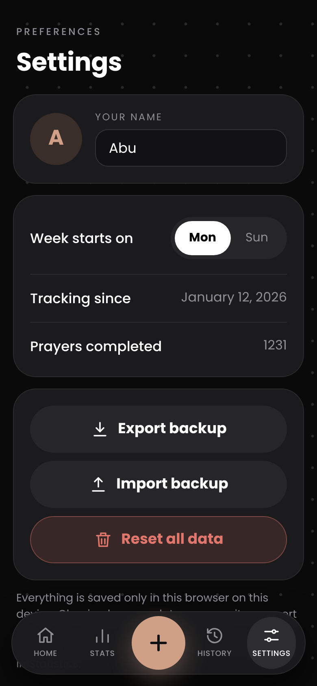
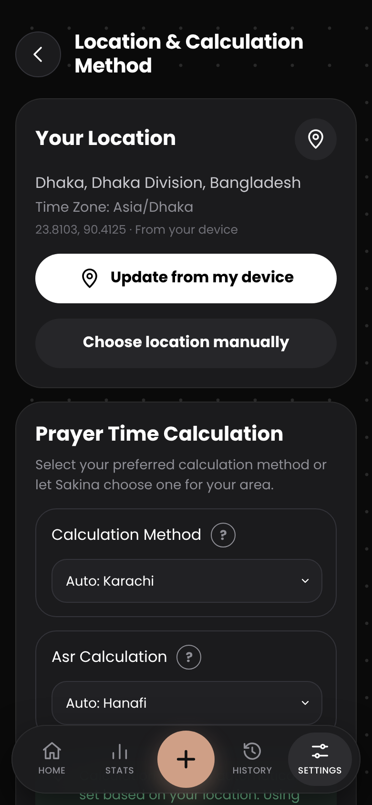

<div align="center">


# Sakina

**A calm, private daily prayer tracker.**<br>
See your next prayer, mark each prayer you complete, and watch your streak grow.


[About](#about) · [Screenshots](#screenshots) · [Features](#features) · [Prayer times](#prayer-times) · [How tracking works](#how-tracking-works) · [Backup and import](#backup-and-import) · [This repository](#this-repository)

</div>

---

## About

Sakina (Arabic for *calm* and *tranquility*) is a mobile-first website for tracking the five daily prayers: **Fajr, Dhuhr, Asr, Maghrib and Isha**.

It is one HTML file. There is no backend, no account, no framework and no library. Your records and settings are saved in your own browser and never leave your device.

Prayer times are **calculated on your device** from the position of the sun, using the location and method you choose. There are no fixed or placeholder times.

## Screenshots

<div align="center">
<table>
  <tr>
    <td align="center"><br><sub><b>Home</b></sub></td>
    <td align="center"><br><sub><b>Statistics</b></sub></td>
    <td align="center"><br><sub><b>History</b></sub></td>
    <td align="center"><br><sub><b>Settings</b></sub></td>
    <td align="center"><br><sub><b>Location &amp; Method</b></sub></td>
  </tr>
</table>
<sub>Screenshots use sample data.</sub>
</div>

## Features

**Home**
- Next prayer card with start time, live countdown and a progress ring
- Daily progress ring and streak counter
- One tap to mark each prayer as completed
- Weekly activity strip. Tap a day to view or fix it
- This week: completed, missed, completion rate and full days
- Large center button for quick logging from any page

**Statistics**
- Overall completion ring, current streak, longest streak and perfect days
- Totals for done, missed, days tracked and perfect days
- Full-year activity map with a year dropdown. Colors show 1 to 5 prayers per day, and missed days have their own color

**History**
- Prayer summary for each of the five prayers, with a time range filter
- A detailed card for every day with all five prayers
- Tap any prayer on any past day to correct it

**Settings**
- Theme and Design style (placeholders for a future update)
- Location & Calculation Method
- About
- Name, week start, backup export and import, reset

## Prayer times

Open **Settings → Location & Calculation Method**.

**Location**
- Share your device location to detect your address, city, region, country and time zone
- Or choose a place manually: search by name, or enter latitude, longitude and time zone
- If location permission is denied, the manual options open automatically

**Calculation**
- Method is selected automatically for your country, and you can change it
- Asr rule is selected automatically (Hanafi or Shafi), and you can change it
- The **?** buttons explain each method and Asr rule
- Times are recalculated whenever the location or settings change

| Method | Fajr | Isha | Best for |
| --- | --- | --- | --- |
| ISNA | 15° | 15° | United States, Canada |
| MWL | 18° | 17° | Europe, Far East, parts of the Americas |
| Egyptian | 19.5° | 17.5° | Africa, Syria, Iraq, Lebanon, Malaysia |
| Umm al-Qura | 18.5° | 90 min after Maghrib | Saudi Arabia, Gulf states |
| Karachi | 18° | 18° | Pakistan, Bangladesh, India, Afghanistan |
| Tehran | 17.7° | 14° | Iran, some Shia communities |

**Adjustments:** move Fajr, Sunrise, Dhuhr, Asr, Maghrib and Isha earlier or later by up to 60 minutes to match your local mosque timetable.

**Privacy:** your coordinates are sent to OpenStreetMap only when you tap detect or search, to look up an address. Prayer times themselves never need the internet.

Device location needs a secure page (https). GitHub Pages is secure. If you open the file directly from your phone storage, use the manual option.

## How it works

| Term | Meaning |
| --- | --- |
| Completed | A prayer you manually marked as completed. |
| Pending | A prayer for today that has not been marked yet. |
| Missed | A prayer that remains incomplete after its day has ended. |
| Completion rate | Completed prayers divided by completed plus missed prayers. Pending prayers are excluded. |
| Streak | Consecutive days on which all five prayers were completed. An unfinished current day does not break the streak. |
| Start date | Tracking begins on the first day you use Sakina, or the earliest date included in an imported backup. |

You cannot log future days.

Sakina is a personal tracking tool. It does not verify whether a prayer was performed and does not replace prayer-time guidance.

## Backup and import

The website stores prayer records in browser `localStorage` using the key:

` sakina:v1 `

Your records remain in that browser when you refresh or close the page. Clearing browser data can remove them, so export a backup periodically.

The Settings page provides backup export and import.

Importing a backup adds its prayer records to your history. Years present in the imported records can also appear in the Statistics year selector.

### Backup file format

Backups use JSON format:

```json
{
  "app": "sakina",
  "start": "2021-03-01",
  "days": {
    "2021-03-01": ["fajr", "dhuhr", "asr", "maghrib", "isha"],
    "2021-03-02": ["fajr", "isha"]
  }
}
```

Prayer IDs:

- `fajr`
- `dhuhr`
- `asr`
- `maghrib`
- `isha`

Dates use the `YYYY-MM-DD` format. Future dates are ignored during import.

**Important:** Browser storage and Android app storage are not automatically the same. Keep an exported backup if you need to move your records between browsers or devices.

## Android app

The Android application is built around the Sakina website.

Current Android version: **1.1.0**

- Application name: Sakina Prayer Tracker
- Package ID: `org.axon.sakina`
- Update checking: Checks GitHub for available app updates when the app opens and an internet connection is available.
- Current website loading: Uses the hosted Sakina website.

### Planned improvements

The following improvements are planned for future Android updates:

- Bundle the complete website inside the APK for offline access.
- Add location-based features and time-zone support.
- Improve native Android data storage.
- Add an Android-focused backup and restore experience.

These are planned features and are not part of the current 1.1.0 release.

## Installation

### Website

1. Visit the [Sakina website](https://axon469.github.io/Sakina-Prayer-Tracker/).
2. Open it in a modern browser.
3. Start tracking your prayers.

### Android

1. Open the [GitHub Releases page](https://github.com/axon469/Sakina-Prayer-Tracker/releases).
2. Open the latest release.
3. Download the APK file.
4. Install it on your Android device.

Android may ask you to allow installation from your browser or file manager. Only install APKs from a source you trust.

## This repository

The repository contains the website source, Android application project, build workflow and supporting images.

| Path | Purpose |
| --- | --- |
| `index.html` | Website source: HTML, CSS and JavaScript. |
| `app/` | Native Android application project. |
| `.github/workflows/` | GitHub Actions build workflow. |
| `update.json` | Information used by the Android update checker. |
| `assets/` | Website logo and other assets. |
| `screenshots/` | Images used in this README. |
| `README.md` | Project documentation. |
| `LICENSE` | Project license. |

### Run the website locally

1. Download or clone this repository.
2. Open `index.html` in a modern web browser.
3. Start using Sakina.

No web server or package installation is required for the basic website.

## Privacy

Sakina is designed to keep prayer tracking simple and personal.

- No account or registration is required.
- The website stores prayer records in browser storage.
- The prayer-tracking feature does not require a backend database.
- The current Android app needs internet access to load the hosted website and check for updates.
- The fully offline Android experience is planned for a future release.

Remember that browser data can be lost if you clear the browser's stored data. Export a backup periodically.

## License

Sakina is open-source software licensed under the **MIT License**.

You are free to use, copy, modify, merge, publish, distribute, sublicense and sell copies of the software, subject to the terms of the license.

See the [LICENSE](LICENSE) file for the complete license text.

---

<div align="center">
  <sub>Made with care. May Sakina bring a little more calm and consistency to your daily routine.</sub>
</div>
